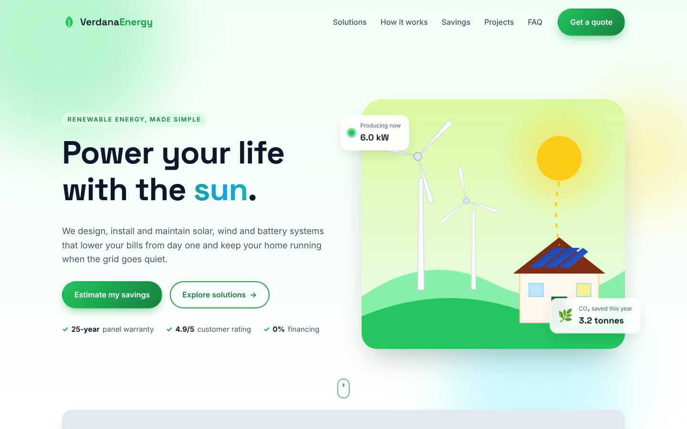
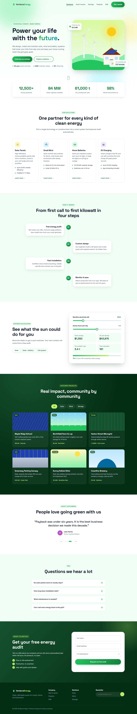
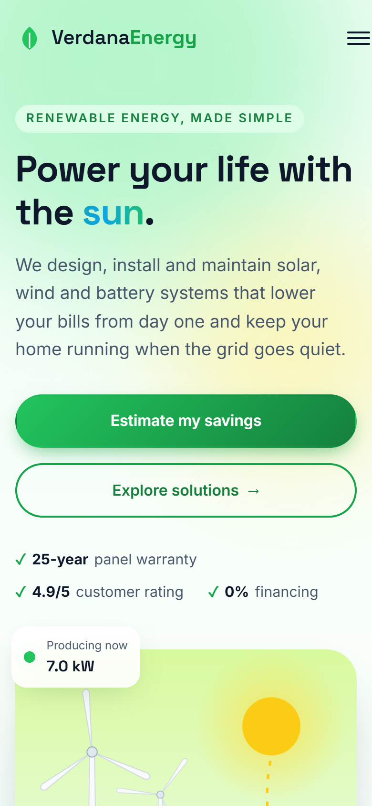
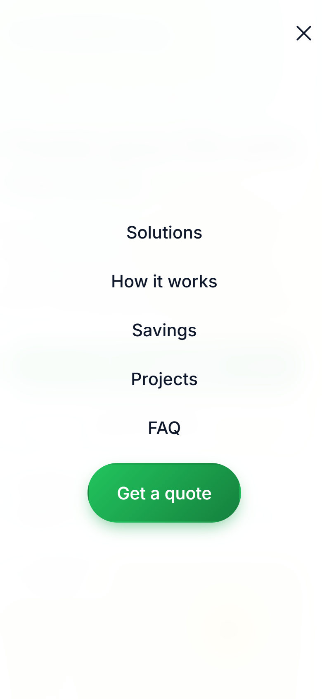

# Verdana Energy: Animated Landing Page (HTML, CSS, JavaScript)

A one-page website for a fictional solar and clean energy company, built with plain HTML, CSS and JavaScript. No frameworks, no build step: open `index.html` and it works.



## The Goal

A small energy installer needs a page that does three jobs: explain what they offer in plain words, show a visitor how much money they could save, and turn that interest into a quote request. It also has to feel modern and work well on a phone, where most visitors arrive.

## What the Page Does

- **Hero with a living scene.** An SVG illustration with spinning wind turbines, a glowing sun and solar panels on a house. The headline word changes every few seconds (sun, wind, future, planet), a "Producing now" card shows a live kW value that ticks up and down, and the background blobs move slightly with the mouse.
- **Animated counters.** Four key numbers count up from zero when they scroll into view.
- **Solutions cards** for solar, wind, batteries and EV charging, with a 3D tilt and spotlight effect on hover.
- **"How it works" timeline** with four steps that slide in from alternate sides while a line fills as you scroll.
- **Savings calculator.** Two sliders (monthly bill, sunny hours per day) and three system types. It updates yearly savings, 25-year savings, CO₂ avoided, a tree equivalent and a coverage meter in real time. The formula and its assumptions ($0.16 per kWh, about 0.4 kg CO₂ per kWh, about 21 kg CO₂ per tree per year) are written as comments in `script.js`.
- **Project gallery with filters** (All, Solar, Wind, Storage).
- **Testimonial slider** with arrows, dots, autoplay and swipe on touch screens.
- **FAQ accordion.**
- **Quote form with validation.** Name, email and "interested in" are checked in the browser; invalid fields shake and turn red, and a valid form shows a loading state and a personal thank-you message. The form is front-end only: it does not send data anywhere yet, so it can be connected to any back end (PHP, a form service, email).
- **Navigation details:** sticky header, scroll progress bar, active menu link that follows the section on screen, mobile burger menu (closes with Esc or a link tap), back-to-top button, newsletter field.

## Quality

- Responsive layout from 320 px phones to wide desktops.
- Accessibility basics: semantic sections, `aria-expanded` on the menu and accordion, labels on every form field, keyboard-friendly controls.
- Respects the system **"reduce motion"** setting: animations are turned off for people who ask for that.
- Light and fast: three files, no libraries, only Google Fonts loaded from outside.

## Tech Stack

HTML5, CSS3 (Grid, Flexbox, custom properties, keyframe animations), vanilla JavaScript (IntersectionObserver, no dependencies), inline SVG.

## Screenshots

| Desktop | Mobile | Mobile menu |
|---|---|---|
|  |  |  |

Full mobile page: [screenshots/mobile-full.png](screenshots/mobile-full.png)

## How to Run

Download or clone the folder and open `index.html` in any modern browser. That's it.

To serve it locally instead (optional):

```bash
python -m http.server 8000
# then open http://localhost:8000
```

To publish it, upload the three files to any static hosting (GitHub Pages, Netlify, shared hosting).

## Project Structure

```text
green-energy-site/
├── index.html      # page markup and SVG illustrations
├── style.css       # layout, theme, animations, responsive rules
├── script.js       # all interactions (calculator, slider, form, menu...)
└── screenshots/
```

## Note

Verdana Energy, its projects, numbers and testimonials are fictional. This is a portfolio demo, not a real company.
